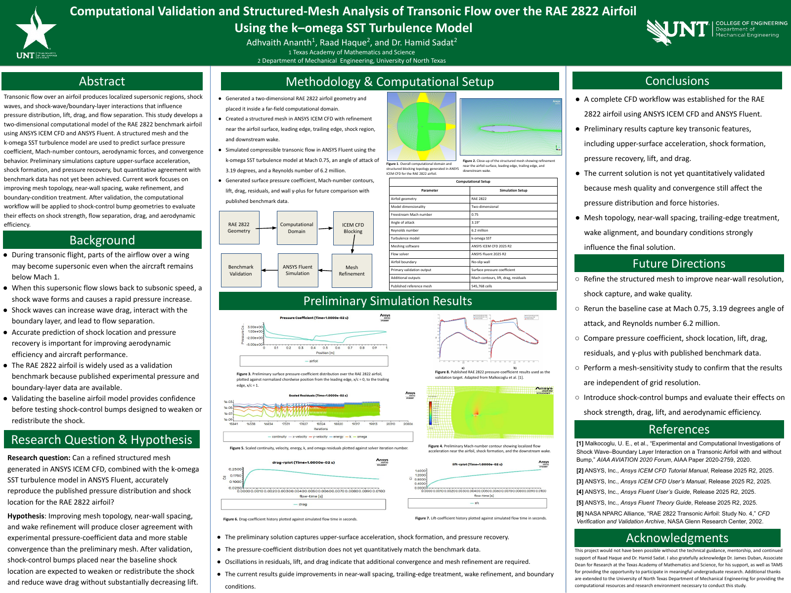

# Adhvaith Ananth
### Aerospace engineering · Computational fluid dynamics · Aviation technology · Public policy

I am a student at the Texas Academy of Mathematics and Science at the University of North Texas, Class of 2027. My work explores how engineering analysis, software, and clear communication can improve aviation and space systems.

This portfolio brings together my app, research poster, technical manuscripts, and policy work. Project pages identify my role, collaborators, and the current stage of the work.

## Selected projects

| Project | My work | Materials and status |
| --- | --- | --- |
| **[AeroSync: Smarter Journeys](https://adhvaitha-cpu.github.io/AeroSync/)** | Founder and developer; Swift/SwiftUI travel planning, airport pickup coordination, and PDF itineraries | [App Store](https://apps.apple.com/app/id6815097927) · [Project repository](https://github.com/AdhvaithA-cpu/AeroSync) · Released iPhone/iPad app |
| **[Transonic RAE 2822 Airfoil](research/rae-2822/)** | Structured meshing, compressible-flow simulation, and benchmark comparison under research mentorship | Original research poster · Preliminary results; validation ongoing |
| **[Transonic Airfoil CFD Literature Review](writing/transonic-airfoil-review/)** | Review of mesh resolution, turbulence models, shock prediction, and numerical reliability | LaTeX source · Literature review / demonstration manuscript |
| **[Passenger Aviation Communication](policy/passenger-communication/)** | Policy brief and legislative proposal developed through the YIP fellowship | Two original PDFs · Educational policy proposal |
| **[Who Pays for the Next Space Station?](writing/space-station-financing/)** | Coauthored analysis of government customers and commercial orbital infrastructure | LaTeX source · Working manuscript |
| **[Beyond the Kármán Line](writing/orbital-safety/)** | Coauthored proposal for current spacecraft safety and disposal records | LaTeX source · Submitted article / working manuscript |
| **[How CFD Shapes Spaceflight](writing/cfd-spaceflight/)** | Explanation of CFD applications across a space mission, with NASA case studies | LaTeX source · Submitted article / working manuscript |

## Research spotlight

**Computational Validation and Structured-Mesh Analysis of Transonic Flow over the RAE 2822 Airfoil Using the k–omega SST Turbulence Model**  
Adhvaith Ananth, Raad Haque, and Dr. Hamid Sadat

The poster documents a computational workflow and preliminary results. It explicitly identifies remaining mesh and convergence work; the baseline is not yet quantitatively validated.

## Additional engineering experience

- **Surface-piercing cylinder CFD:** ANSYS Fluent validation work on air–water flow and mean/fluctuating forces under UNT research mentorship. Simulation files are not included here.
- **FTC Technobotz, Team 23542:** Arm-hook adaptation, paper-airplane launcher refinement, robot wiring, and outreach as part of a team. Team hardware and code are not included here.
- **TAMS ACES rocketry:** Contributions to rocket construction, testing, and flight-data review. Flight files are not included here.

## Technical background

ANSYS Fluent and ICEM CFD · Swift and SwiftUI · Python · MATLAB · CAD · LaTeX · Technical and policy writing

## About these materials

This is a selected project portfolio, not a claim that all work is complete or published. Submitted articles are not described as accepted or peer-reviewed. Coauthored work retains credit to Renish Joshi; the research poster retains its original research-team attribution. Sources and acknowledgments are included in the manuscripts.

The extended résumé was used as background and is not uploaded because it includes personal contact details. No credentials or private app configuration are included. No blanket reuse license is granted over third-party figures, institutional marks, or coauthored materials.
